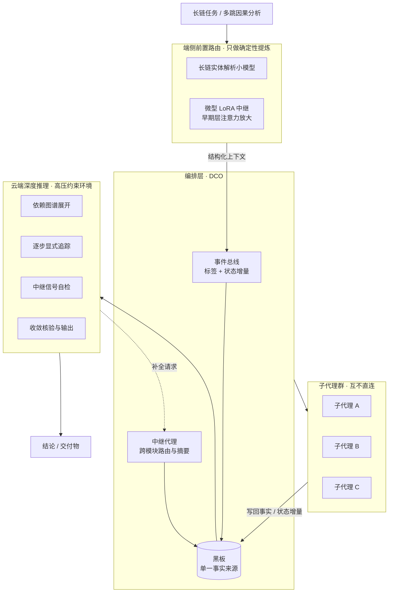

# DCO 架构说明

DCO（Distributed Cognition Orchestrator，分布式认知编排官）是这套系统的中枢角色：它不亲自做推导，只负责维护事实源、路由任务、同步状态增量，并在收敛前把链路补齐。

## 分层拓扑

## 数据流

1. **前置路由**：端侧小模型先把长链里的实体、指代、依赖抽出来，转成确定性上下文。云端拿到的是「已经解引用过的」输入，而不是一堆模糊代词。
2. **入总线**：提炼结果以事件标签 + 状态增量写入事件总线，不使用自然语言广播。
3. **落黑板**：黑板是全局唯一事实来源。子代理只读黑板、只写增量，不互相私聊。
4. **子代理执行**：中继代理按依赖图谱派活、收摘要、做去重。子代理之间不建连，幻觉传染半径被限制在单个节点内。
5. **高压收敛**：云端在零容错约束下按四阶段闭环推进，任一步发现链路断裂就打回中继层补全，不允许带缺口收敛。
6. **回写**：输出结果与新增事实写回黑板，供后续任务复用。

## 关键设计取舍

| 维度 | 点对点网状 | 黑板 + 中继 |
| --- | --- | --- |
| 通信复杂度 | O(n²) | O(n) |
| 事实一致性 | 各自持有副本，易漂移 | 单一事实源，可追溯 |
| 幻觉传染 | 沿全连接扩散 | 隔离在单节点 |
| 状态同步 | 自然语言广播，冗余高 | 事件标签增量，低延迟 |
| 瓶颈 | 无中心，难以裁决 | 中继代理，需做摘要与超时 |

## 与过早停机的关系

编排层能解决「信息散落」，但解决不了「隐藏层信号衰减」。前者靠拓扑，后者只能在模型内部或协议层处理：

- **可改权重**：在早期单层注入微型低秩适应模块（LoRA），中继并放大注意力信号，冻结基座其余部分。
- **不可改权重**：用 `dco-skill-explicit-chain-reasoning` 强制显式展开，把原本发生在隐藏层的中继搬到可见 token 空间。
